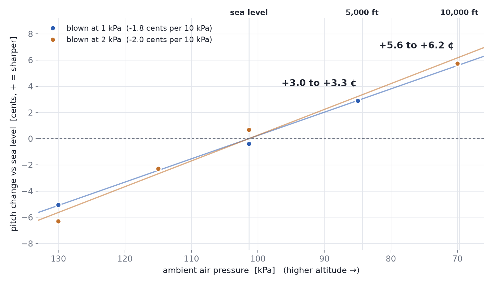
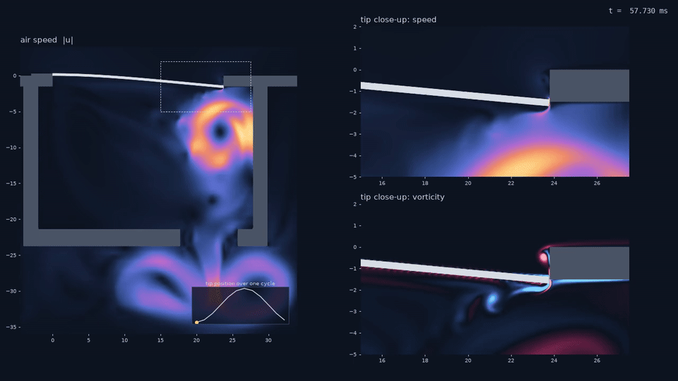
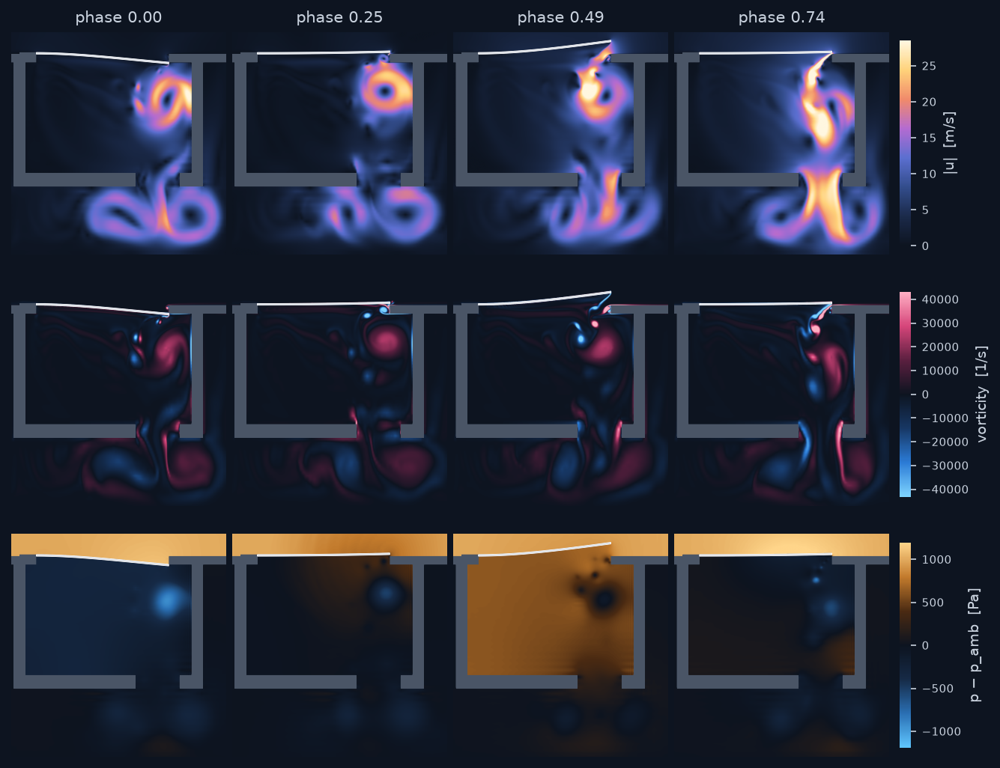
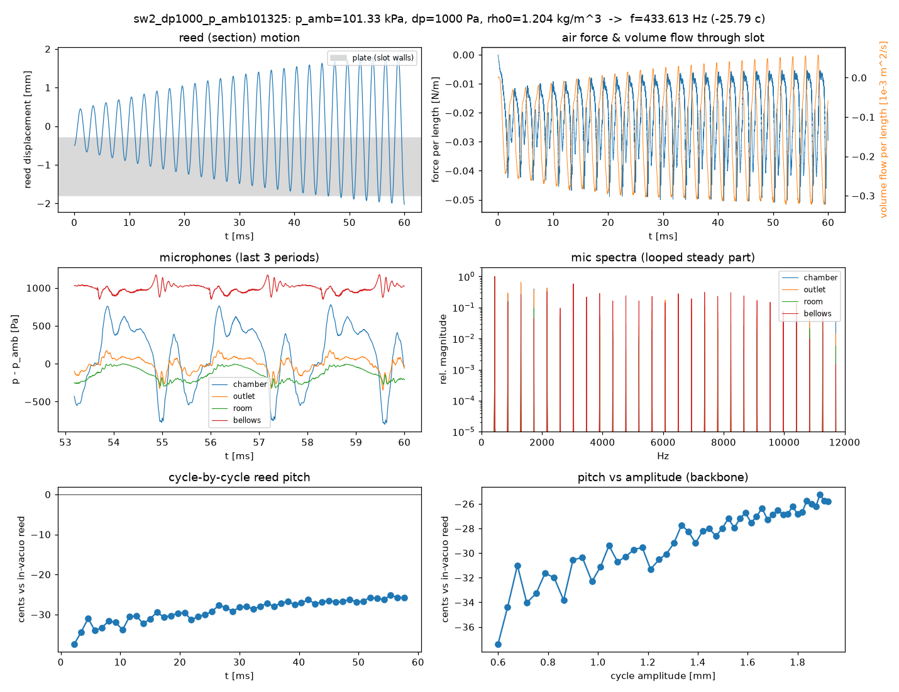

# Reed pitch at altitude

**How far does an accordion reed drift out of tune when you play it in the mountains?**
A GPU fluid-dynamics simulation of a blown A4 free reed says it goes **sharp**:

| | ambient pressure | air density (20 °C) | pitch vs sea level |
|---|---|---|---|
| sea level | 101.3 kPa | 1.20 kg/m³ | 0 |
| **5,000 ft** | 84.3 kPa | 1.00 kg/m³ | **+3 cents** (+3.0 to +3.3) |
| **10,000 ft** | 69.7 kPa | 0.83 kg/m³ | **+6 cents** (+5.6 to +6.2) |

The ranges cover the two bellows pressures simulated (1 and 2 kPa). Temperature is
held at 20 °C, as for an instrument played indoors, so only the air pressure changes.

<picture>
  <source media="(prefers-color-scheme: dark)" srcset="poster/altitude_dark.png">
  
</picture>

Each point is a full simulation (60 ms, about 26 reed cycles) at that ambient
pressure. The slope is **−1.8 cents per +10 kPa** at 1 kPa blowing and −2.0 cents
at 2 kPa.

### What that means for a player

* Six cents is near the limit of what most people hear between two notes played
  one after the other. Against a fixed reference played at the same time, such
  as a tuner, a keyboard or a sea-level recording, it shows up as about 1.5 beats
  per second at A4.
* Every reed shifts in the same direction, so the accordion stays roughly in tune
  with itself. This study simulated only A4. Lower reeds are larger and carry a
  different share of air mass, so the shift may vary across the keyboard.
* Treat these numbers as an **upper bound**. The 2-D model confines the air more
  than a real reed's surroundings do, which likely exaggerates the air loading
  (see [Limits](#limits)).

## Why thinner air makes the reed sharper

A vibrating reed has to push air out of its way every cycle. That air moves with
the tongue and acts as **extra mass**, which lowers the pitch. At sea level the
air is denser, so there is more extra mass and the reed is flatter. At altitude
the air is thinner and the reed rises toward its in-vacuum pitch.

There is an opposing effect: the air trapped in the reed chamber acts as a
spring, and a stiffer spring raises the pitch. In the simulation the added mass
wins clearly.

In absolute terms the simulated reed sounds about 30 cents below its in-vacuum
pitch (440.1 Hz) at sea level. Extrapolated to zero air density, about 11 of
those cents remain, coming from the blowing flow itself. The other ~18 cents
scale with air density, and that part produces the altitude shift.

## What the air is doing



The steel tongue (white) swings through the slot in the aluminium reed plate
(grey). Air from the bellows (top, at ambient pressure plus the bellows pressure)
squeezes through the gap around the tongue as it opens. The jet rolls up into a
vortex pair (the two lobes) every cycle, crosses the reed chamber and leaves
through the outlet at the bottom. The close-ups show the tip, where the jet
separates from the tongue and the plate edge.



Rows show air speed, vorticity (spin: red is counter-clockwise, blue clockwise)
and pressure relative to ambient. Columns are four points in one cycle at sea
level, blowing at 1 kPa. The chamber pressure swings by about ±700 Pa each cycle,
which is the sound the reed makes.

## Listen

Loop tones of the simulated pressure inside the reed chamber, blown at 1 kPa
(8 s, 48 kHz WAV; GitHub can't play audio inline, so download them):

* [sea level](poster/audio/sea.wav)
* [5,000 ft](poster/audio/ft5k.wav)
* [10,000 ft](poster/audio/ft10k.wav)
* [sea level and 10,000 ft together](poster/audio/beat.wav): the ~5 cent
  difference between their final cycles beats at about 1.3 Hz.

> **They sound thin and artificial.** This is the raw pressure next to the reed.
> A real accordion's sound also passes through the reed block, the body and
> grille, the bellows, and the room, which add resonances and filter the tone.
> None of those are modelled. Each clip also repeats one simulated cycle, so it
> has none of a real reed's small cycle-to-cycle variation. Use the clips to
> compare pitch, not tone.

## How the simulation works



* **Geometry:** a 2-D slice along the reed tongue. The reed is an A4 treble
  tongue: spring steel, 23.75 × 2.5 × 0.30 mm, 440.1 Hz in vacuum. Its tip is set
  0.3 mm above a 1.5 mm reed plate, with a 50 µm side clearance. Below the plate
  are a reed chamber and an outlet to the room.
* **Reed:** a bending cantilever with three vibration modes, driven by the air
  pressure along its whole length.
* **Air:** compressible Navier–Stokes on a stretched grid with cells down to
  25 µm (121k cells), using finite volumes and moving cut cells for the tongue.
  The slice can't show the openings along the tongue's sides, so a sub-grid
  model passes air through the tongue. Its flow speed and momentum come from the
  local pressure difference, the same way the resolved tip jet's do. That leak
  carries 85–90% of the flow, in line with a 3-D estimate for a real reed.
* **Ambient pressure:** at fixed temperature it enters only through the air
  density `ρ = p/(RT)`. The speed of sound and viscosity don't depend on
  pressure.
* **Pitch measurement:** the reed starts from rest and builds up to oscillation
  by itself. It is still growing slowly at 60 ms, and pitch rises with amplitude,
  so runs are compared at the same tip amplitude (1.28 mm at 1 kPa, 1.70 mm at
  2 kPa), cycle by cycle.
* **Hardware:** a custom mixed-precision CUDA solver (numba-cuda, CUDA graphs).
  Each run is 2.2 million time steps of 27 ns. A batch of 10 runs takes about
  70 minutes on an RTX 4090.

### Checks

* **Grid refinement:** a finer adapted grid (532 × 443 cells, smallest 16.7 µm)
  moves the pitch by 0.4–1.2 cents and the amplitude growth by under 1%. That is
  much smaller than the ±6 cent altitude effect, and the comparison between
  pressures uses the same grid.
* **Boundary pressures:** the bellows holds 996–998 Pa above ambient at a 1 kPa
  setting at every ambient pressure (1987 Pa at 2 kPa).
* Numbers for every run are in [`results/`](results/).

## Limits

* **2-D:** the slab confines the air in the third dimension, which likely
  overstates the added mass. The absolute flattening (~30 cents) is too large,
  and the altitude slope is best read as an upper bound.
* **One note, one setup:** A4, set 0.3 mm, one chamber shape. Bass reeds may
  differ.
* **Temperature:** held at 20 °C. In the standard atmosphere it is −5 °C at
  10,000 ft. That changes the air (and the steel slightly) and is not included.
* **Not fully settled:** at 60 ms the amplitude is still creeping up by about
  1–2% per cycle. The matched-amplitude comparison accounts for that, but the
  final playing amplitude is not reached.

## Run it yourself

Needs an NVIDIA GPU and Python 3.12:

```bash
python -m venv .venv && . .venv/bin/activate
pip install "numpy<2.4" scipy matplotlib numba "numba-cuda[cu13]"
python reed_side.py --prefix sw --p-amb 70e3 85e3 101325 115e3 130e3 --dp 1000 2000 --kick=-0.5e-3 --t-end 0.06
python compare.py runs/sw_*                        # pitch at matched amplitude
python poster_chart.py runs/sw_dp_compare.json     # the chart above
python reed_side.py --prefix an --dp 1000 --kick=-0.5e-3 --t-end 0.06 --snap-per-cycle 72   # 72 frames per cycle
python render_fields.py runs/an_run --out poster --movie   # stills.png, flow.gif
```

| file | what |
|---|---|
| `reed_side.py` | the side-view GPU model used here |
| `analysis.py` | pitch cycle by cycle, WAVs, plots |
| `compare.py` | pitch at matched amplitude across runs |
| `poster_chart.py`, `render_fields.py` | figures on this page |
| `regrid.py` | adapt the grid to a pilot run (used for the refinement check) |
| `reed2d.py`, `reed_gpu.py`, `reed_gpu_fp64.py`, `sweep.py` | the earlier cross-section model (CPU and GPU); it never self-oscillates |
| [`docs/MODEL.md`](docs/MODEL.md) | model details and the history of both slicings |
